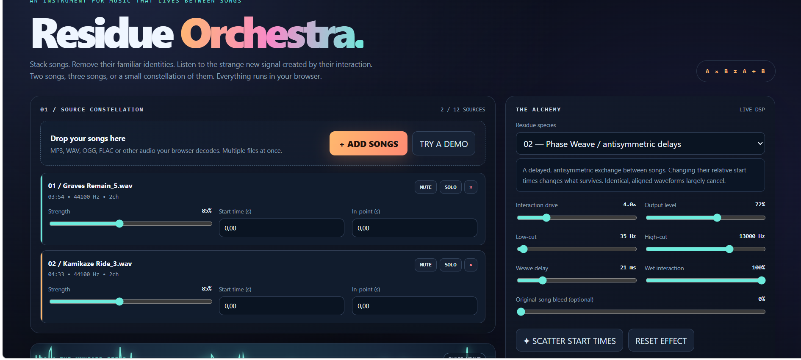

# FridayLolSol — Residue Orchestra

A browser instrument for hearing sounds that arise **between** songs, rather than just mixing them.

**Load 2–12 tracks** (MP3, WAV, FLAC, OGG, or other files your browser can decode). Each track has an independent gain, start time on the shared timeline, in-point within the source, mute, solo and remove. Pick active track pairs, then listen to nonlinear cross-interactions. Songs are decoded to RAM locally; nothing is uploaded. The UI includes an original 3-voice synthetic demo so you can try it instantly.

## Play

GitHub Pages is configured for this repository. When its deployment finishes, open:

https://anttiluode.github.io/FridayLolSol/

Alternatively, **double-click index.html** in Chrome/Edge. The complete audio worklet is embedded in the HTML and is loaded through a data: URL when opened as a local file (file://). If the browser blocks inline worklet modules, use Python's local HTTP server instead:

    python -m http.server 8000

Open http://localhost:8000 in a recent Chrome or Edge browser. HTTPS / localhost is the reliable fallback if your browser restricts local file AudioWorklets.

## Controls

Choose the **Residue species** and press PLAY. Use START TIME to shift when a track begins; use IN-POINT to skip into the source. The pair matrix defines which track pairs interact, and whether triples have all three edges. PHASE WEAVE is sensitive to small timing offsets. SCATTER START TIMES shifts tracks by up to 0.3 seconds. Adjust output level before turning up interaction drive.

The optional DRY control blends in the ordinary source sum. It defaults to **0%**, making the output only the interaction. REC records live playback and downloads a browser-supported compressed audio file (typically WebM/Opus) on stopping. This is a live recording, not an offline render.

## The four audible residues

These are creative DSP transformations **inspired** by time-frequency cross-terms, not inverse Wigner–Ville transformations.

1. **CROSS-PULSE:** for each enabled pair, ring multiplication: r(t) = 2*x_i(t)*x_j(t). Pure tones make sum and difference sidebands that neither track alone contains.
2. **PHASE WEAVE:** delayed, antisymmetric product: r(t) = 4*[x_i(t)*x_j(t-delay) - x_j(t)*x_i(t-delay)]. If two tracks are identical and aligned, they cancel.
3. **IMPRINT:** r(t) = 2*[x_i(t)*envelope_j(t) - x_j(t)*envelope_i(t)]. Each envelope is a short peak follower, leaving a briefly decaying trace.
4. **TRIPLE HELIX:** r(t) = 8*x_i(t)*x_j(t)*x_k(t), requiring a triangle of three enabled pairs. With fewer than three active tracks, wet output is zero.

Multiple interaction terms are normalized by square root of their count, high-pass and low-pass filtered, and soft-limited using tanh.

This does not claim anything quantum about the music, and it is not stem separation. You are listening to constructed relationships between waveforms. Songs are played at their original speeds; tempo or beat matching is manual.

## Structure

- index.html — self-contained GUI plus embedded copy of worklet for double-click file:// support, Web Audio player, synthetic demo, live visualization, recording.
- residue-worklet.js — 12-input stereo DSP processor with the four residue modes.
- tests/residue.test.cjs — Node.js processor tests (no dependencies).
- .github/workflows/tests.yml — test workflow.
- GitHub Pages is published by the repository's existing automatic Pages deployment.

## Notes

All source audio remains local to the browser. Large numbers of full-length songs can consume substantial RAM. Recording uses MediaRecorder and browser-supported audio compression. Please only share recordings for which you have the appropriate rights.

Made for curiosity, not for pretending that a mathematical cross-term is a mystical new song.
